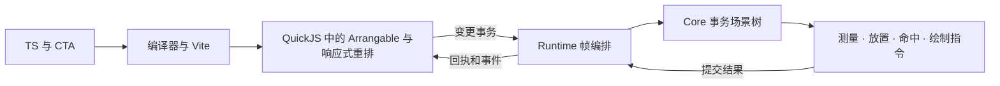
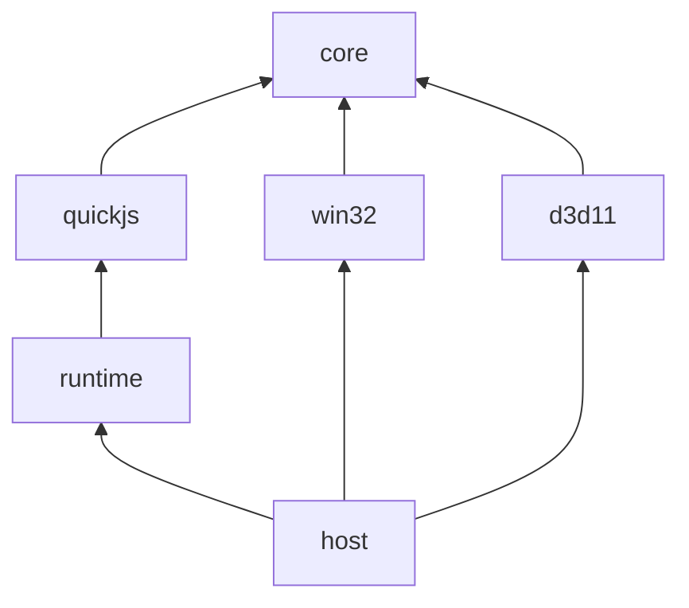
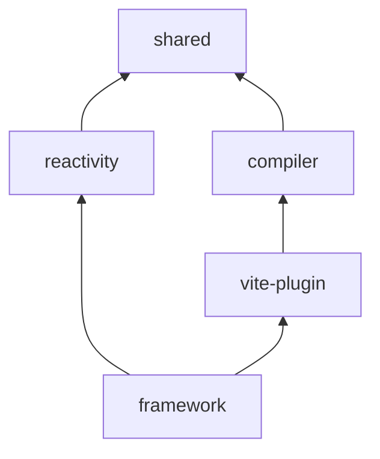

# Canton 架构

Canton 面向 Windows 用户态桌面。TS 和 `.cta` 声明界面，QuickJS-NG 执行应用逻辑，C++20 管理场景、布局、输入和帧产物。

| 目录 | 职责 |
| --- | --- |
| [`packages/compiler`](../packages/compiler) | 编译 `.cta`：模板、TS setup、值单位检查与降级，以及离线类型检查 `checkCtaProject`。 |
| [`packages/vite-plugin`](../packages/vite-plugin) | 把编译器接入 Vite：`.cta` 转换与 HMR、开发期模块快照、UI 包与字节码构建钩子。 |
| [`packages/framework`](../packages/framework) · [`packages/reactivity`](../packages/reactivity) | Arrangable、响应式状态、重组、动画和 UI 原语；framework 打包其余各包对用户发布。 |
| [`packages/shared`](../packages/shared) | TS 和 Native 共用的协议定义，包括 Modifier 原生协议表、值单位契约与版本常量。 |
| [`native/src/core`](../native/src/core) | 事务场景树、测量和放置、输入状态机、命中与保留绘制指令，以及各层共用的日志与单调时钟。独立于 QuickJS、Win32 和 D3D11。 |
| [`native/src/quickjs`](../native/src/quickjs) | JS 上下文、模块装载、Native 协议桥，以及 `canton_ui_bytecode`。 |
| [`native/src/runtime`](../native/src/runtime) | 帧调度和提交、事件回送、诊断以及资源和包加载的编排接口。 |
| [`native/src/win32`](../native/src/win32) | Win32 平台资产。目前有从 HWND 接入的精确触控板滚动和控制台日志着色。 |
| [`native-tests`](../native-tests) · [`tests`](../tests) | Native（CTest）与 TS（node:test）测试。 |
| [`cli`](../cli) | Windows 工具链发现、进程和文件事务、缓存与构建工具。 |

重排产生候选事务。帧流程用同一棵场景树派生布局、命中快照与绘制指令，成功提交后再发布。输入命令和帧回执经运行时回到脚本侧。字体注册及预加载计数、Native Painter 注册归宿主实例所有。

## Native 分层

- 箭头即允许的依赖方向。`win32`、`d3d11` 只依赖 `core`，由 `host` 统一装配到 `runtime`；不允许反向或绕道 include。
- 命名空间与目录一一对应（`canton::core`、`canton::quickjs`、`canton::runtime`、`canton::win32` 等）；顶层 `canton::` 只留给 `native/include/canton` 的公开 SDK。
- QuickJS-NG 必选，不保留无脚本引擎的编译分支。
- 理由见 [batch2 ADR 001](adr/batch2/1：Native模块分层、依赖方向与命名空间.md)。

宿主窗口、D3D11 渲染与 DirectWrite、Live 网络、Dist 包挂载和扩展 SDK 的实现边界见 [batch1 ADR 006](adr/batch1/6：D3D11渲染管线、HLSL着色器与离屏层.md) 和 [batch1 ADR 009](adr/batch1/9：宿主加载规矩、Native统一结构与扩展交付.md)。`native/src/host`、`native/src/d3d11` 和 `native/include/canton` 为对应实现预留。

## TS 分层

- 包之间单向依赖；vite-plugin 只在运行期按包导出解析 framework 的 HMR 客户端与内部入口，不静态导入 framework。
- compiler 按编译阶段平铺：`syntax/` → `template/` → `cta/` → `script/` → `values/`，根目录组装 `compileScript`、`checkCtaProject` 与公开入口。
- framework 按目录分层，自下而上：`values/` → `native/`（原生协议、日志、资产）→ `runtime/` → `animation/`、`draw/` → `layout/` → `modifier/` → `bridge/`（结构提交、Modifier 降级、事件适配）→ `arrangable/` → `app/`；根目录只放分层入口。
- 各包零循环导入（含仅类型的导入），规则由 `tests/runtime/package-layers.test.ts` 检查。理由见 [batch2 ADR 002](adr/batch2/2：TS包分层、依赖方向与命名.md)。

## 待清算

以下部分仍服务于旧加载模型或旧 CLI 流程，暂按原样保留，随对应里程碑重造或清算，不在此前修补：

- `scripts/` 中围绕“用户消费 Native 源码”的部分（如 `verify-native-fetchcontent.ts`、`native-source-cache.ts`）：宿主改为预编译交付后，用户不再编译 Native，届时随扩展 SDK 的交付方式一并重定。格式化脚本依赖外部 `rg`，另行处理。
- `tests/` 与 `native-tests/` 中依赖旧加载模型、尚未接通 D3D11 与新 App 模式的用例：M3 起逐步清算，反应式、重组事务、动画、Modifier 等不依赖宿主的用例预计沿用。
- `cli/` 的命令、受管项与测试：新 App 模式在 CLI 的落地（`canton.project.yaml`、创建工程、受管范围、dev/build）随 M8 讨论后重造；`create`、`sync` 尚未接入，`UiBuildService`、`DevSupervisor`、`IconAssetsService`、`NativeReadiness` 目前只有测试引用。
