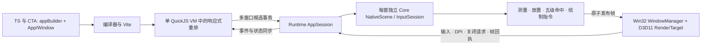
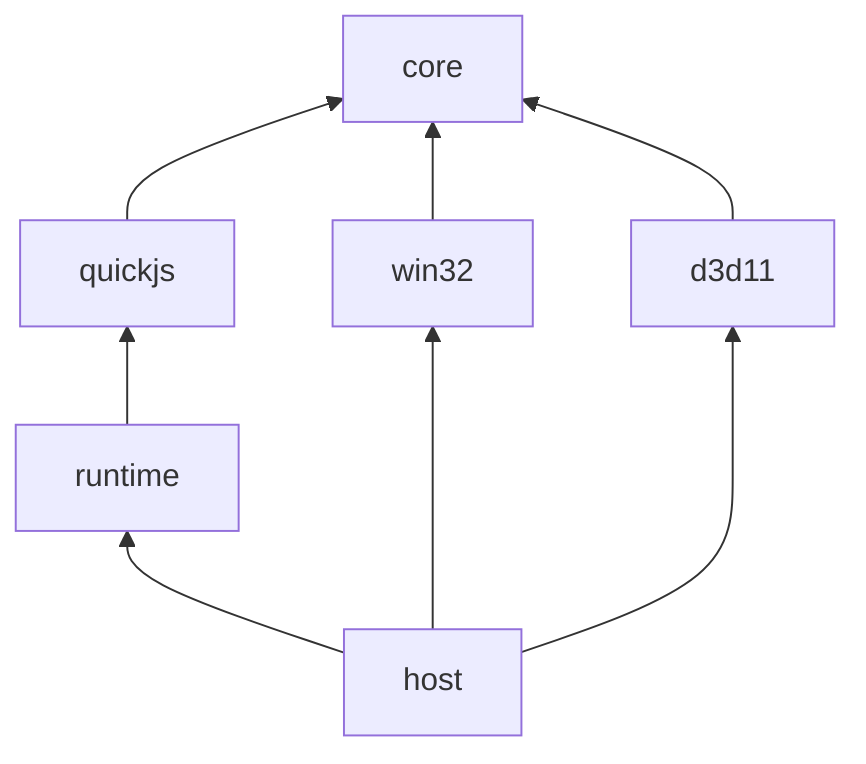
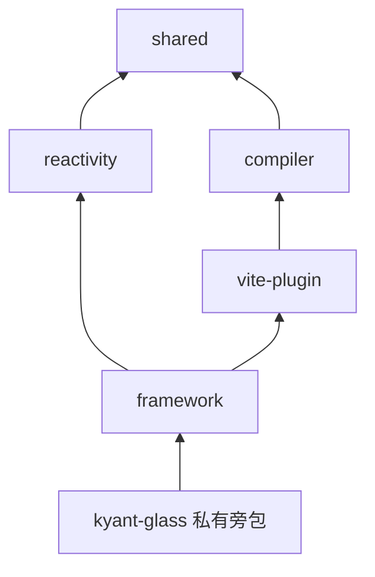

# Canton 架构

Canton 面向 Windows 用户态桌面。TS 和 `.cta` 以 `appBuilder(Root).build()`、`<App>` 与 `<Window>` 声明多窗口界面，单个 QuickJS-NG VM 执行应用逻辑，C++20 按“1 VM : N 原生表面”管理多窗口场景、布局、输入和帧产物。

| 目录 | 职责 |
| --- | --- |
| [`packages/compiler`](../packages/compiler) | 编译 `.cta`：模板、TS setup、值单位检查与降级，以及离线类型检查 `checkCtaProject`。 |
| [`packages/vite-plugin`](../packages/vite-plugin) | 把编译器接入 Vite：`.cta` 转换与 HMR、`.hlsl` Live 自接受热替换与 Dist 期 `koffi` 直调 `d3dcompiler_47.dll` 预编译 `.dxbc`、开发期模块快照、UI 包与字节码构建钩子。 |
| [`packages/framework`](../packages/framework) · [`packages/reactivity`](../packages/reactivity) | `appBuilder`、`<App>` / `<Window>`、`WindowState` / `WindowHandle`、Arrangable、响应式状态、重组、动画、图形/着色器/离屏合成原语、`GraphicsEnvironmentKey`、`LaunchRequestKey`、`useTimeout`/`useInterval`/`delay`、`assets.exists`，以及 `./shell`（托盘/双轨菜单/SMTC/Jump List）、`./fs`（路径重定位与异步/原子文件 I/O）、`./net`（WinHTTP 异步请求与流式下载）；framework 打包其余各包对用户发布。 |
| [`packages/kyant-glass`](../packages/kyant-glass) | 私有旁包（`private: true`），基于 `@canton/framework` 公开出口实现液态玻璃折射、色散、高光与级联背景模糊，并订阅 `GraphicsEnvironmentKey` 在 `reduced` 档自动降级为半透明表面 + 细描边；严禁引用内部模块。 |
| [`packages/shared`](../packages/shared) | TS 和 Native 共用的协议定义，包括 Modifier 原生协议表、值单位契约、`<canton.hlsl>` 虚拟头与版本常量。 |
| [`native/src/core`](../native/src/core) | 事务场景树、测量和放置、绘前 `onGloballyPositioned` 几何派发、指针/滚轮/焦点/显式 `compositionRange` 文本编辑状态机、五级窗口非客户区命中、保留绘制指令、着色器反射封包、`RenderLayer` 环检测与桌面平台纯值结构体（`PlatformTypes.h`）。独立于 QuickJS、Win32 和 D3D11。 |
| [`native/src/quickjs`](../native/src/quickjs) | 单实例 JS 上下文、模块装载与默认导出启动、按窗口隔离的事务与事件槽账本、`globalThis` 定时器/`queueMicrotask`/`AbortController`/`AbortSignal` 启动注入、`QuickJsPlatformApi`（图形环境/启动载荷/文件/网络/Shell 桥接），以及 `canton_ui_bytecode`。 |
| [`native/src/runtime`](../native/src/runtime) | `AppSession`（1 VM : N 窗口会话编排）与 `SceneHost`（单视口编排）、`IoThreadPool`（共享后台 I/O 线程池）、`TimerQueue`（单调时钟最小堆定时队列）、`HttpClient`（完整异步 WinHTTP 与流式原子下载器）、`AppPaths`（`SHGetKnownFolderPath` 与三级透明重定位）与 `FileSystem`（UTF-16 长路径异步与原子替换写）、`SingleInstanceGuard`（互斥体 + 命名管道 IPC 热唤醒）、`InputTextSession`、诊断、加载策略（`lfd`/`live`/`dist`）、0 窗错误屏兜底、UI 包挂载、资源获取与存在性查询。Live 客户端单独成库，只有 Dev 宿主链接。 |
| [`native/src/d3d11`](../native/src/d3d11) | 单 `Renderer` 设备共享字形/路径图集（WARP 软渲染下从 512×512 按需倍增扩容至 2048×2048，空闲离屏 RT 按 2 帧阈值回收，硬件 60 帧）、纹理缓存与按桶离屏 RT 池，派生任意个窗口或离屏 `RenderTarget`；内置着色器、`d3dcompiler_47.dll` + `D3DReflect` 用户 HLSL SM 5.0 管线、两 Pass 可分离模糊与 `RenderEffect`、29 种 `BlendMode`、组透明度、`RenderLayer` 合成、路径覆盖率、DirectWrite 排版、设备丢失重建（含 `deviceGeneration` 递增）与垂直同步线程。输入只有 core 的发布帧。 |
| [`native/src/win32`](../native/src/win32) | Win32 多窗口与桌面 Shell 资产：`Window` 与 `WindowManager`（Owner 拓扑逆序销毁、非阻塞模态锁计数、DWM 材质/圆角、自绘标题栏非客户区三键托管、Per-Monitor V2 DPI、`ITaskbarList3` 任务栏进度/角标/7 槽缩略图按钮、鼠标/光标/键盘、DirectManipulation 触控板滚轮、纯 IMM32 输入法与剪贴板）、App 级隐藏顶层 `HWND`（`WS_EX_TOOLWINDOW`，零显存承接定时消息循环 `MsgWaitForMultipleObjectsEx`、`WM_FONTCHANGE`/`WM_SETTINGCHANGE`/`WM_QUERYENDSESSION`/`TaskbarCreated` 与系统图形偏好查询）、`ShellTray`（稳定 `NIF_GUID` 托盘与原生 `HMENU`）、`MediaSession`（WinRT COM ABI SMTC）、`JumpList`（`ICustomDestinationList`）与控制台日志着色。 |
| [`native/src/host`](../native/src/host) | 宿主入口：装配 `AppSession`、`Renderer`、`WindowManager` 与 VBlank。出两份制品，`canton-host-dev.exe` 读 `CANTON_DEV_*` 环境变量并注入 Live、窗口级诊断插件 `DiagnosticsHud`（HUD 角标/FPS/气泡 + `DiagnosticsOverlay` 帧时间/闪红/框框）、App 级 `DevInputHandler`（`F5`–`F11`）以及未处理异常崩溃栈捕获（`CANTON_DEV_CRASH_LOG`），`canton-host.exe` 写死 Dist 且物理剥离上述开发期代码；`CANTON_ENABLE_DEV` 只出现在这里和构建接线里。 |
| [`native-tests`](../native-tests) · [`tests`](../tests) | Native（CTest）与 TS（node:test）测试；无头回归 `canton_render_regression` 支持单视口及多窗口指定目标窗离屏出图，与 `native-tests/baselines` 比对（WARP 逐像素、硬件按容差）。 |
| [`cli`](../cli) | Windows 工具链发现、进程和文件事务、缓存与构建工具。 |

重排在单 VM 内跨窗口原子生成候选事务。`AppSession` 按需驱动有变更或有动画的窗口执行 `SceneFramePipeline`，全部候选通过后再统一发布并向脚本回送回执；无可见窗口且发生异常时自动立起兜底错误窗。每个 `<Window>` 独立持有 `Density` 与 `FocusManager`，共享同一 `FontRegistry`、`DWriteTextMeasurer` 与 `d3d11::Renderer`。

## Native 分层

- 箭头即允许的依赖方向。`win32`、`d3d11` 只依赖 `core`，由 `host` 统一装配到 `runtime`；不允许反向或绕道 include。
- 命名空间与目录一一对应（`canton::core`、`canton::quickjs`、`canton::runtime`、`canton::win32`、`canton::d3d11`、`canton::host`）；顶层 `canton::` 只留给 `native/include/canton` 的公开 SDK。
- QuickJS-NG 必选，不保留无脚本引擎的编译分支。
- 理由见 [batch2 ADR 001](adr/batch2/1：Native模块分层、依赖方向与命名空间.md)。

宿主窗口、外观、模态、Shell 与存储、D3D11 渲染与 HLSL 离屏合成、图形感知降级、定时与网络、Live 网络、Dist 包挂载和扩展 SDK 的实现边界见 [batch1 ADR 001](adr/batch1/1：Windows用户态目标、应用入口与受管工程.md)、[003](adr/batch1/3：App与Window模型、Owner与模态.md)–[006](adr/batch1/6：D3D11渲染管线、HLSL着色器与离屏层.md)、[008](adr/batch1/8：只读资产与真实文件存储的二元路径模型.md)–[009](adr/batch1/9：宿主加载规矩、Native统一结构与扩展交付.md)，[batch2 ADR 004](adr/batch2/4：Dev宿主的环境变量与随包位置.md)–[009](adr/batch2/9：多窗口状态切分、0窗错误屏兜底与纯IMM32组合输入.md)，[batch3 ADR 001](adr/batch3/1：HLSL着色器、离屏合成与布局坐标架构.md)，以及 [batch4 ADR 001](adr/batch4/1：专注D3D11单后端、图形能力感知与渐进降级.md)–[004](adr/batch4/4：窗口任务栏高亮提醒与FlashWindowEx.md)。`native/include/canton`（扩展 SDK）仍为 M7 预留。

## TS 分层

- 包之间单向依赖；vite-plugin 只在运行期按包导出解析 framework 的 HMR 客户端与内部入口，不静态导入 framework；`kyant-glass` 只允许导入 `@canton/framework` 公开出口，严禁依赖内部路径或 `shared`。
- compiler 按编译阶段平铺：`syntax/` → `template/` → `cta/` → `script/` → `values/`，根目录组装 `compileScript`、`checkCtaProject` 与公开入口。
- framework 按目录分层，自下而上：`values/` → `native/`（原生协议、日志、资产、异步文件系统与网络客户端）→ `runtime/`（含 `RearrangeSurface` 画区分界与作用域定时器 `useTimeout`/`useInterval`/`delay`）→ `animation/`、`draw/` → `layout/`（含 `DensityKey`、`GraphicsEnvironmentKey`、`LaunchRequestKey`）→ `modifier/`（含 `WindowState`、`WindowHandle` 与焦点请求器）→ `bridge/`（多窗口表面提交、Modifier 降级、事件适配）→ `arrangable/`（`<App>`、`<Window>`、`<Layout>`、Shell 声明组件及基础组件）→ `app/`（`appBuilder`）；根目录只放分层入口（`index`/`foundation`/`ui`/`animation`/`shell`/`fs`/`net`/`internal`/`vite`）。
- 槽位参数只存在于类型：编译产物用类型约束每次调用的内容表（转译时擦除），运行期按值传给内容函数。只对特定父布局或所属窗口画区有意义的 Modifier（权重、对齐、填充、标题栏拖拽区与三键）分别由对应 Handle 构造，在降级与原生边界按所属作用域校验。约定见 [batch1 ADR 002](adr/batch1/2：Slot句柄与父布局数据.md)、[batch2 ADR 003](adr/batch2/3：槽位参数只在类型层面、父布局数据按种类校验.md) 与 [009](adr/batch2/9：多窗口状态切分、0窗错误屏兜底与纯IMM32组合输入.md)。
- 各包零循环导入（含仅类型的导入），规则由 `tests/runtime/package-layers.test.ts` 检查。理由见 [batch2 ADR 002](adr/batch2/2：TS包分层、依赖方向与命名.md)。

## 待清算

以下部分仍服务于旧加载模型或旧 CLI 流程，暂按原样保留，随对应里程碑重造或清算，不在此前修补：

- `scripts/` 中围绕“用户消费 Native 源码”的部分（如 `verify-native-fetchcontent.ts`、`native-source-cache.ts`）：宿主改为预编译交付后，用户不再编译 Native，届时随扩展 SDK 的交付方式一并重定。
- `cli/` 的命令、受管项与测试：新 App 模式在 CLI 的落地（`canton.project.yaml`、创建工程、受管范围、dev/build）随 M8 讨论后重造；`create`、`sync` 尚未接入，`UiBuildService`、`DevSupervisor`、`IconAssetsService`、`NativeReadiness` 目前只有测试引用。
